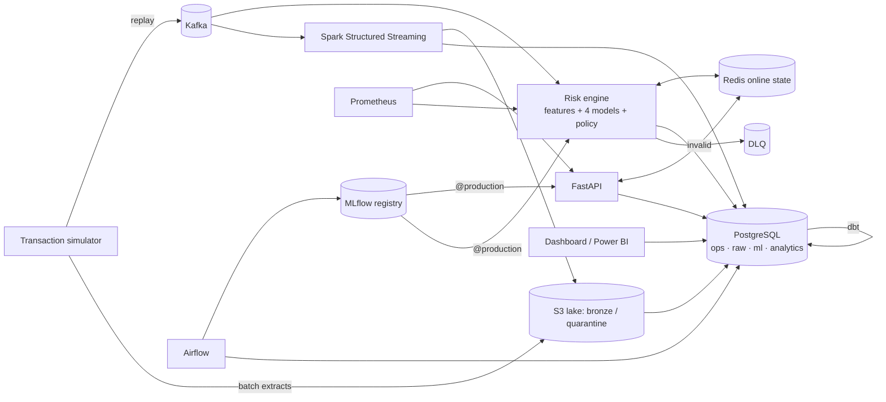
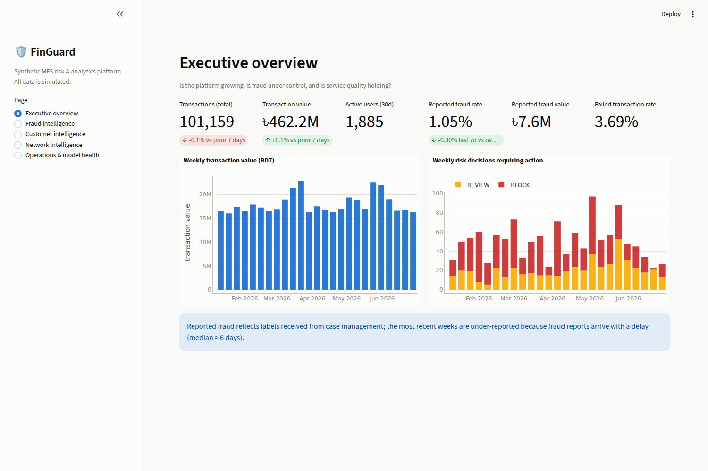
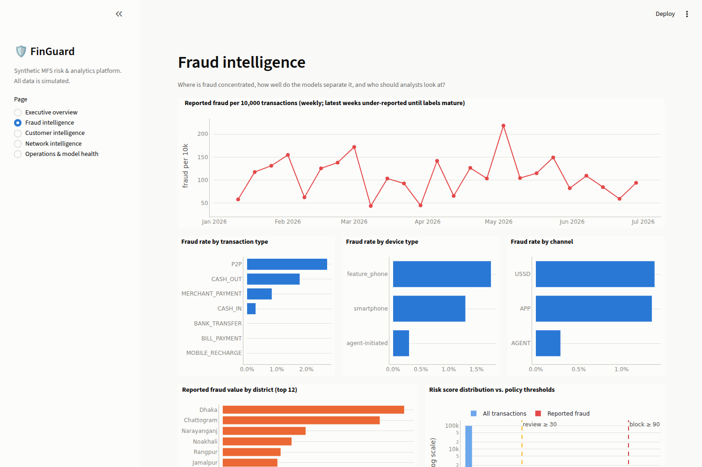
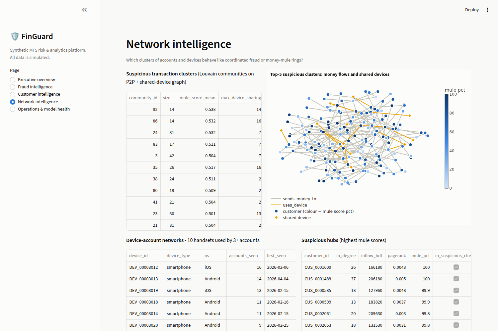
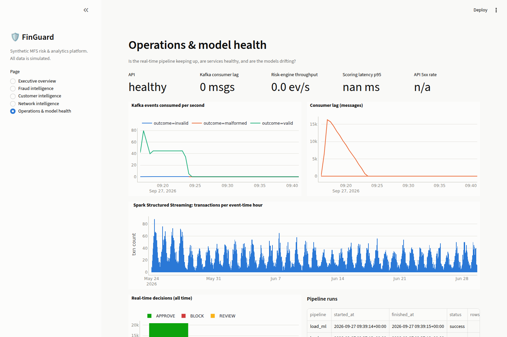

# FinGuard

**Real-time AI-powered transaction intelligence, fraud detection and customer analytics for a
simulated Mobile Financial Services (MFS) platform.**

Kafka · Spark Structured Streaming · Redis · PostgreSQL · dbt · Airflow · MLflow · XGBoost ·
scikit-learn · NetworkX · FastAPI · Prometheus · Streamlit · Docker Compose

> **Disclaimer.** FinGuard is a portfolio / research engineering project. Every customer,
> account, device, merchant and transaction is **synthetic**, generated by the included
> simulator. The platform is modelled on the *architectural characteristics* of mobile-wallet
> ecosystems (P2P, cash-in/out via agents, merchant and bill payments, recharge), but it is not
> connected to, derived from, or endorsed by bKash, Nagad or any bank or financial institution.

---

## Contents
1. [Overview & problem statement](#1-overview--problem-statement)
2. [Business use cases](#2-business-use-cases)
3. [Architecture](#3-architecture)
4. [Data architecture](#4-data-architecture)
5. [Streaming architecture](#5-streaming-architecture)
6. [Feature engineering](#6-feature-engineering)
7. [ML architecture](#7-ml-architecture)
8. [Fraud scenarios](#8-fraud-scenarios)
9. [Results: model comparison & evaluation](#9-results-model-comparison--evaluation)
10. [API examples](#10-api-examples)
11. [Dashboard](#11-dashboard)
12. [Run it locally](#12-run-it-locally)
13. [Train models](#13-train-models)
14. [Run streaming](#14-run-streaming)
15. [Tests](#15-tests)
16. [Scale](#16-scale)
17. [Repository layout](#17-repository-layout)
18. [Limitations](#18-limitations)
19. [Future work](#19-future-work)

---

## 1. Overview & problem statement

A mobile wallet processes a continuous stream of small, fast, irreversible payments. Fraud
comes in several shapes: stolen credentials and phones (account takeover), social-engineering
scams where the genuine customer sends the money, and money-mule networks that collect and cash
out stolen funds. Any control has three hard constraints:

* **Decide in milliseconds** on the authorisation path, using the customer's *history*.
* **Minimise friction**: a blocked salary transfer is also a failure.
* **Learn from labels that arrive days later**, and prove the models work without leaking the future.

FinGuard implements the full loop: a realistic synthetic data generator with 12 labelled fraud
scenarios → Kafka → a stateful real-time risk engine and Spark Structured Streaming → an S3 data
lake and a PostgreSQL warehouse modelled with dbt → supervised, unsupervised, behavioural, ATO,
graph, segmentation and churn models tracked in MLflow → a FastAPI decision service with
explainable reasons, a business policy kept outside the models, monitoring and dashboards.

Everything in this README was run end to end on the Docker stack; **every number is produced by
the pipeline** and stored in [`reports/`](reports/).

## 2. Business use cases

| Use case | Where |
|---|---|
| Approve / review / block a transaction in real time, with reasons | `POST /risk/score`, Kafka risk engine |
| Detect account takeover (stolen phone, PIN brute force, impossible travel) | ATO model, `account_takeover_risk_score` |
| Find money-mule rings and device farms | Graph analytics, network dashboard |
| Analyst work queue with explanations | `ops.fraud_alerts`, `GET /fraud/alerts`, dashboard |
| Customer 360 risk profile | `GET /customer/{id}` |
| Behavioural segmentation for product/marketing | K-Means segments, customer dashboard |
| Churn early warning for retention | Churn model (30-day horizon) |
| Executive and operations reporting (Power BI-ready) | dbt star schema in `analytics.*` |
| Model governance: versioning, promotion, rollback, drift | MLflow registry, monitoring job |

## 3. Architecture



Why each component exists, the data/ML pipelines, the decision flow, the star schema and the
transaction graph are diagrammed in **[docs/architecture.md](docs/architecture.md)**.

Design choices worth highlighting:
* **One feature engine for training and serving.** The training table is produced by *replaying*
  history through the exact code the API and stream use → no training/serving skew and no
  look-ahead leakage by construction (with tests proving both).
* **ML prediction ≠ business decision.** Models output calibrated probabilities and SHAP reasons;
  `configs/policy.yaml` maps `risk_score = 100·max(P(fraud), P(ATO))` to APPROVE/REVIEW/BLOCK.
* **At-least-once everywhere, idempotent everywhere**: dedup before state updates, `ON CONFLICT`,
  full-refresh loads, upserts, checkpoints.
* **Late labels are first-class**: training only sees fraud reported before the cutoff.

## 4. Data architecture

```
simulator ─► data/synthetic/*.parquet ─► DQ gate ─► S3 lake raw/ (event_date partitions)
          ─► PostgreSQL raw.* (TRUNCATE+COPY) ─► dbt staging ─► dims/facts ─► reporting marts
Kafka ─► Spark ─► S3 bronze/ (append-only) + quarantine/ ; windows ─► ops.*
Kafka ─► risk engine ─► ops.risk_decisions / ops.fraud_alerts ─► dbt fact_fraud_predictions
ML pipelines ─► ml.* (scores, segments, churn, graph, profiles) ─► dim_customer, marts
```

* **Star schema** (`analytics`): `fact_transactions`, `fact_fraud_predictions`,
  `fact_customer_activity`; `dim_customer`, `dim_device`, `dim_merchant`, `dim_date`,
  `dim_location`; reporting marts for the dashboard/Power BI. Grain, keys and lineage:
  [docs/data_dictionary.md](docs/data_dictionary.md).
* **69 dbt tests** (keys, relationships, accepted values, ledger arithmetic, no activity before
  registration) — all passing.
* **Data quality** (`python -m data_engineering.validation`): schema drift, nulls, duplicates,
  invalid amounts/timestamps/IDs/enums, impossible balances, referential integrity →
  [`reports/data_quality_synthetic.md`](reports/data_quality_synthetic.md) (19/19 checks pass on the
  extracts). On the Spark bronze zone the same job flags exactly the 217 duplicate deliveries
  that were injected (212 from the replay + 5 from integration tests):
  [`reports/data_quality_bronze.md`](reports/data_quality_bronze.md).

## 5. Streaming architecture

* **Kafka (KRaft)**: `fg.transactions` (6 partitions, key = `customer_id` for per-customer
  order), `fg.alerts`, `fg.transactions.dlq`, compacted `fg.customers`/`fg.devices`.
  Idempotent producer (`acks=all`).
* **Risk engine** (`services/risk_engine/worker.py`): validating consumer → DLQ for schema
  violations and poison records (after retries) → `SET NX` de-duplication → features from Redis
  → models → policy → idempotent writes; offsets committed after persistence (at-least-once).
* **Spark Structured Streaming** (`streaming/spark_jobs/transactions_stream.py`): parse &
  validate → quarantine; append-only bronze Parquet partitioned by `event_date`;
  `withWatermark("event_time", "10 minutes")` + `dropDuplicatesWithinWatermark` → per-customer
  sliding windows (5 min/1 min, 1 h/15 min) and per-minute throughput, emitted in append mode
  when final and upserted to PostgreSQL; checkpoints on the lake.

Watermarks, late data and state management are explained in
[docs/architecture.md §7](docs/architecture.md#7-streaming-semantics).

## 6. Feature engineering

61 point-in-time features in six groups (transaction, behavioural, temporal, device,
geographic, network) — e.g. counts in the last 1 min / 5 min / 1 h / 24 h, amount vs. the
customer's own baseline, share of history at this hour, new device / district / recipient,
accounts per device, implied travel speed, receiver in-degree, minutes since last inflow,
outflow/inflow ratio. Catalogue: [`features/definitions.py`](features/definitions.py);
method: [docs/ml_methodology.md](docs/ml_methodology.md).

## 7. ML architecture

| Model | Type | Label | Output |
|---|---|---|---|
| Fraud A | XGBoost + Platt calibration | `is_fraud` (as reported) | `fraud_probability` + SHAP reasons |
| Fraud B | Isolation Forest | none | anomaly percentile (policy escalation rule) |
| Fraud C | Customer-baseline Fisher score | none | behavioural anomaly percentile + reasons |
| ATO | XGBoost on change-of-controller features | `is_ato` | `account_takeover_probability` / score / reasons |
| Graph | NetworkX metrics + Louvain + mule score | none (evaluated vs hidden truth) | mule score, suspicious clusters, hubs |
| Segmentation | K-Means (k by silhouette) vs HDBSCAN | none | 7 named segments |
| Churn | XGBoost on snapshots | no success in next 30 days | `churn_probability` |
| Profile | combination | – | customer risk level, behaviour, reasons |

Temporal train/validation/test splits (60/20/20 by event time); labels known at the cutoff only;
validation restricted to mature labels; MLflow tracking + registry with
`development → validation → production` aliases and rollback.

## 8. Fraud scenarios

Velocity attack · sudden high value · new device + high value · impossible travel · device-farm
multi-accounting · scam merchants · rapid fund movement · structuring below the BDT 25,000
threshold · mule collection · failed PIN attempts then success · unusual-recipient scam ·
abnormal night-time (stolen phone). Each has a mechanism, a label, a case id and deliberate
overlap with legitimate behaviour (phone upgrades, travel, night-shift workers, family device
sharing, new merchants, big purchases…). Details: [docs/fraud_detection.md](docs/fraud_detection.md).

Default dataset: **101,159 transactions, 2,500 customers, 180 days, 1,132 fraud transactions
(1.12%) in 272 cases, 30 mule accounts**, labels reported with a median 6-day delay.

## 9. Results: model comparison & evaluation

All on the **held-out test period** (last 36 days: 21,152 transactions, 185 fraud).

**Fraud — three approaches at an equal alert budget (top 1% = 212 alerts)**
([report](reports/fraud_model_comparison.md))

| Model | PR-AUC | ROC-AUC | Precision@212 | Recall@212 |
|---|---|---|---|---|
| A. XGBoost (supervised) | **0.804** | 0.996 | 0.665 | 0.762 |
| B. Isolation Forest | 0.370 | 0.911 | 0.349 | 0.400 |
| C. Behavioural baseline | 0.300 | 0.915 | 0.311 | 0.357 |
| Union of A+B+C alert sets | | | | 0.876 (499 alerts) |

**Supervised fraud model at the policy thresholds**: REVIEW (≥30): precision 0.734, recall
0.670; BLOCK (≥90): precision 0.983, recall 0.314. Calibration: Brier 0.0036, ECE 0.0012.
Class weighting was tested and *rejected* on validation (PR-AUC 0.847 unweighted vs 0.694 with
full re-weighting).

| Other models | Result |
|---|---|
| Account takeover | PR-AUC **0.939**, precision 0.851 / recall 0.826 at review threshold |
| Churn (30-day) | ROC-AUC **0.846** vs 0.752 recency baseline; PR-AUC 0.316 (9.4% base rate); Brier 0.072 |
| Mule detection (graph, unsupervised) | PR-AUC 0.698; flagged clusters hold 100% of mules at 9.3× the base rate |
| Segmentation | k = 7, silhouette 0.184, ARI vs hidden personas 0.344 |

**Real-time replay of the test period through Kafka** (with 1% duplicates, 0.5% invalid,
0.5% late events):

| | |
|---|---|
| Decisions | 21,152 for 21,152 unique transactions (exactly once) |
| Duplicates skipped / DLQ | 212 / 107 (all injected invalid records) |
| Fraud flagged (REVIEW+BLOCK) | 136 of 185 (73.5%); BLOCK precision 98.6% (70/71) |
| Scoring latency | p50 **10.4 ms**, p95 13.4 ms (features + 4 models + policy, 1 core) |

Honest caveats: the data is synthetic, so absolute numbers say more about the simulator than
about a real wallet; mule detection at the very top of the list is *not* better than a plain
in-degree ranking (precision@30 0.60 vs 0.73); scam payments made by genuine customers remain
the hardest class (recall 0.44–0.50).

## 10. API examples

```bash
curl -s -X POST localhost:8000/risk/score -H 'content-type: application/json' -d '{
  "event_time": "2026-06-29T21:40:00Z", "customer_id": "CUS_0000100",
  "sender_id": "CUS_0000100", "receiver_id": "CUS_0001999", "amount": 18500,
  "transaction_type": "P2P", "channel": "APP", "device_id": "DEV_NEVER_SEEN",
  "district": "Sylhet", "latitude": 24.89, "longitude": 91.87,
  "balance_before": 21000, "metadata": {"pin_attempts": 3}}'
```
```json
{
  "fraud_probability": 0.008905,
  "account_takeover_probability": 0.21449,
  "account_takeover_risk_score": 21,
  "risk_score": 21,
  "risk_level": "LOW",
  "decision": "APPROVE",
  "risk_reasons": ["New device for this customer", "High transaction amount (BDT 18,500)",
                   "Device has little or no transaction history", "New recipient never paid before"],
  "score_driver": "account_takeover",
  "explanation_note": "Reasons list the factors that contributed most strongly to the model's prediction (SHAP attributions). They describe the model's reasoning, not proof or cause of fraud.",
  "model_version": "fraud-xgb-v1",
  "policy_version": "policy-v1"
}
```
```bash
curl -s localhost:8000/customer/CUS_0000100   # risk level, fraud/ATO/churn probability, segment, behaviour, live state
curl -s "localhost:8000/fraud/alerts?decision=BLOCK&limit=5"
curl -s localhost:8000/transaction/TXN00000090000
curl -s localhost:8000/model/info             # versions, test metrics, lineage, active policy
curl -s localhost:8000/metrics                # Prometheus
```
Full reference: [docs/api.md](docs/api.md) · OpenAPI UI: http://localhost:8000/docs

## 11. Dashboard

Streamlit (http://localhost:8501) over the dbt marts, the API and Prometheus. Power BI can
connect to PostgreSQL and use the same `analytics` schema.

| Executive overview | Fraud intelligence |
|---|---|
|  |  |
| **Network intelligence** | **Operations & model health** |
|  |  |

Customer intelligence (segments, churn, live customer lookup): [screenshot](docs/images/dashboard_customers.png).

## 12. Run it locally

**Option A — full platform (Docker, ~8 GB RAM):**
```bash
git clone <this repo> && cd FinGuardAi
make up          # infrastructure: Kafka, Postgres, Redis, S3 (SeaweedFS), MLflow, Prometheus
make pipeline    # data → DQ → lake → warehouse → features → models → registry → dbt → Redis
make apps        # API, streaming risk engine, Spark streaming, dashboard
make replay      # stream the test period through Kafka
make smoke       # end-to-end smoke test
make airflow     # optional: Airflow at http://localhost:8080 (admin / admin)
```
or simply `make demo`. URLs and operations runbook: [docs/deployment.md](docs/deployment.md).

**Option B — Python only (no services):**
```bash
make install                 # .venv with requirements/dev.txt (Python 3.11)
source .venv/bin/activate
make pipeline-local          # simulator → features → all models (MLflow in ./mlruns)
uvicorn api.main:app         # API with in-memory state and file-backed read models
```

## 13. Train models
```bash
python -m ml train-all            # or: train-fraud | train-ato | graph | segment | churn | profile
python -m ml.fraud_detection.thresholds   # decision-threshold analysis → reports/threshold_analysis.md
python -m ml validate && python -m ml promote   # registry gates, then @production
python -m ml rollback --model finguard-fraud-xgb
mlflow ui --backend-store-uri sqlite:///mlruns/mlflow.db   # local tracking UI
```
In Docker/Airflow the same steps run as DAGs `finguard_01 … finguard_06`, chained by Airflow
Datasets.

## 14. Run streaming
```bash
make apps                                   # risk engine + Spark job
python -m ingestion.kafka_producer --from-split test --rate 300 \
       --duplicate-rate 0.01 --invalid-rate 0.005 --late-rate 0.005   # from the host (Kafka on :9094)
docker compose logs -f risk-engine spark-streaming
```
Watch consumer lag, throughput and latency on the dashboard's *Operations* page or in
Prometheus (`finguard_kafka_consumer_lag_total`, `finguard_scoring_seconds`).

## 15. Tests
```bash
make test               # 76 unit / ML / Spark tests (≈40 s): pytest -m "not integration"
make lint               # ruff
make test-integration   # 5 end-to-end tests against the running Docker stack
```
Covered: feature window arithmetic, novelty flags, **offline == online parity**, Redis == memory
store, **no leakage from future events**, simulator realism/determinism, data-quality detectors,
schemas, policy, metrics, SHAP additivity, model loading & schema checks, temporal/churn split
safety, API contract (health, scoring, 422/404, alerts, metrics), Kafka consumer DLQ/retry/commit,
producer chaos, dedup, the Spark parse/validate/window logic (local Spark), and the integration
paths Kafka→risk engine→Postgres, Kafka→Spark→lake/Postgres, API→model/Redis, warehouse
consistency. Last run: 76 passed; 5/5 integration passed; dbt 69/69.

## 16. Scale

| Preset | `DATASET_SIZE` | Customers | Generation | Feature replay | Peak RAM |
|---|---|---|---|---|---|
| SMALL (default) | 100,000 | 2,500 | 2.5 s | 6.1 s | 0.5 GB |
| MEDIUM | 1,000,000 | 25,000 | 18.8 s | 85.4 s | 3.0 GB |
| LARGE | 10,000,000 | 250,000 | not run here | not run here | plan ≥ 16 GB |

Wall-clock times (including interpreter start-up) and peak RSS, measured on a 4-vCPU
container. `DATASET_SIZE=medium make pipeline`. The offline replay is
single-threaded by design (it is the reference implementation); how to scale it and the online
path is discussed in [docs/interview_guide.md](docs/interview_guide.md#how-would-the-system-scale-to-millions-of-transactions).

## 17. Repository layout
```
simulator/            synthetic entities, personas, 12 fraud scenarios, ledger
ingestion/            event schema (Pydantic), Kafka producer, validating consumer + DLQ, topic admin
streaming/spark_jobs/ Spark Structured Streaming job
features/             point-in-time feature engine, state stores (memory/Redis), offline replay, hydration
ml/                   fraud_detection, account_takeover, anomaly_detection, graph_risk,
                      customer_segmentation, churn_prediction, customer_profile, common (splits,
                      metrics, bundles, calibration, SHAP reasons, MLflow tracking & registry)
services/risk_engine/ scorer, business policy, dedup, sinks, Kafka worker
api/                  FastAPI app, schemas, repositories
data_engineering/     batch pipelines (lake, warehouse), data-quality checks
warehouse/schema/     PostgreSQL DDL (raw, ops, ml, analytics)
dbt/finguard/         staging, star schema, marts, tests, seeds
airflow/dags/         six Dataset-chained DAGs
monitoring/           Prometheus metrics, drift & performance monitoring
dashboards/           Streamlit app
configs/              finguard.yaml, policy.yaml
docker/               Dockerfiles, Postgres/SeaweedFS/Prometheus config
reports/              generated evaluation, DQ and monitoring reports (committed)
docs/                 architecture, data dictionary, ML methodology, fraud detection, API,
                      deployment, interview guide
tests/                unit, ML, Spark and integration tests
notebooks/            exploration notebook
```

## 18. Limitations
* **Synthetic data**: behaviour, fraud mechanics and label delays are assumptions; model quality
  on real traffic would differ. The simulator is the ceiling on realism.
* Single-node Kafka/Redis/Postgres; no TLS/auth, secrets in `.env` — a local demo, not a secure
  deployment.
* The risk engine is at-least-once: a crash between the Redis state commit and the Kafka offset
  commit can re-apply one event to state (bounded, documented; fix = Kafka transactions/outbox).
* Offline feature replay is single-threaded (1M events ≈ 85 s); LARGE was not executed here.
* Multi-worker Redis updates are last-write-wins per entity document (fine with per-customer
  partitioning; shared device/receiver documents would need Lua/atomic ops at high concurrency).
* API and risk engine load models at start-up; a promotion requires a (rolling) restart.
* The behavioural and Isolation Forest models are clearly weaker than the supervised model; they
  are used as escalation signals, not decision-makers.
* Power BI files are not included (the marts are Power BI-ready); the Streamlit dashboard is
  the included UI.

## 19. Future work
* Sequence model over each customer's recent events (transformer) and a GNN (GraphSAGE) for
  rings once enough labelled rings exist — kept out until they beat GBDTs at equal latency.
* Cost-sensitive thresholding (expected loss vs. review cost) and per-segment thresholds.
* Analyst feedback loop: alert dispositions → labels → active learning.
* Schema registry (Avro/Protobuf) and Kafka transactions for exactly-once state updates.
* Incremental dbt models, partitioned facts, a columnar warehouse.
* Shadow/champion–challenger deployment and automated retraining on drift.
* Tenure-normalised counters to remove structural drift in cumulative features.

---
Interview preparation: **[docs/interview_guide.md](docs/interview_guide.md)** · License: MIT
