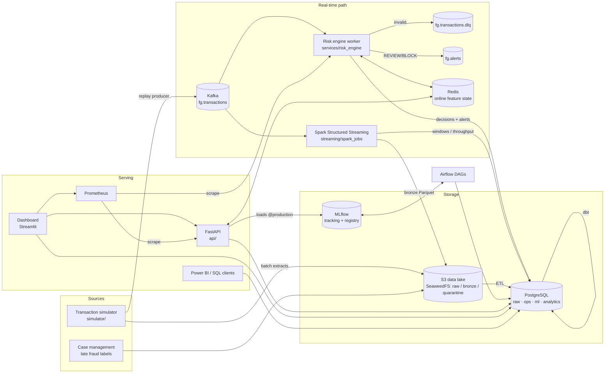
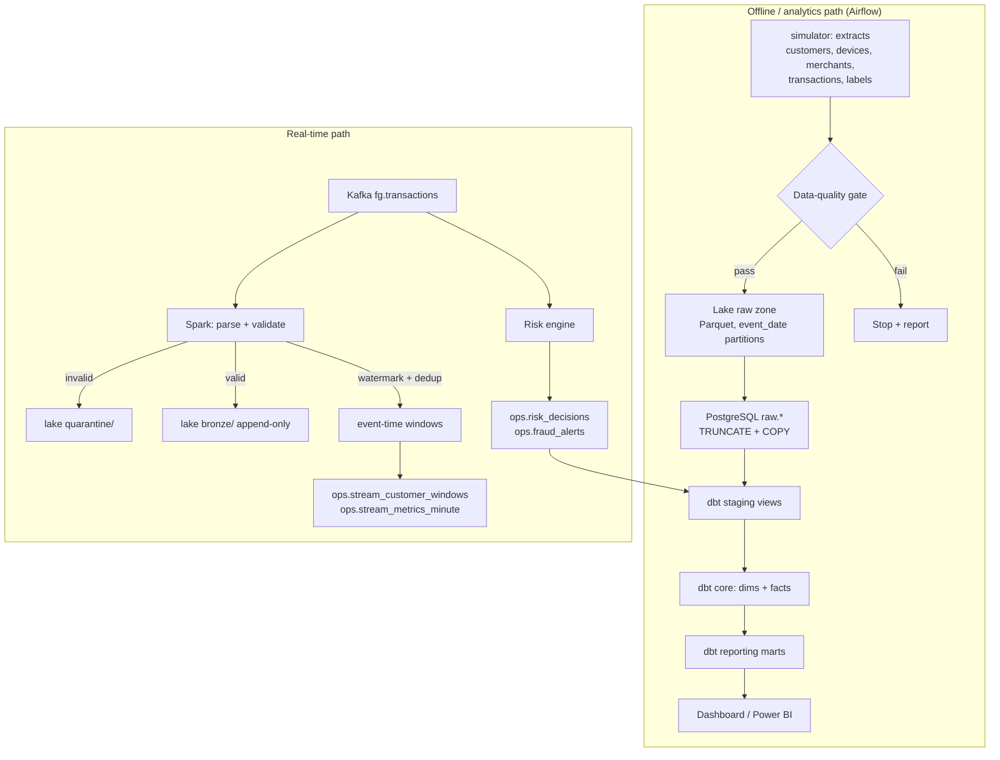
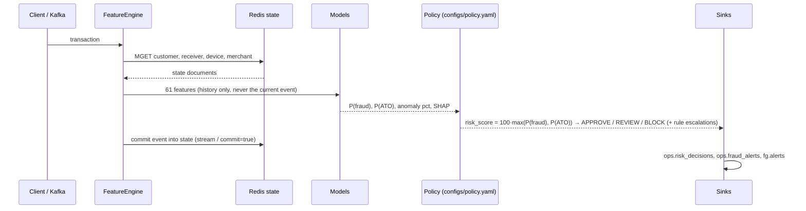
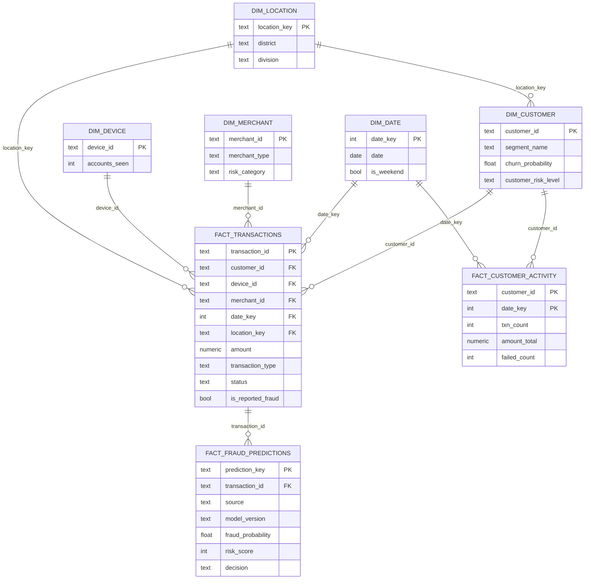
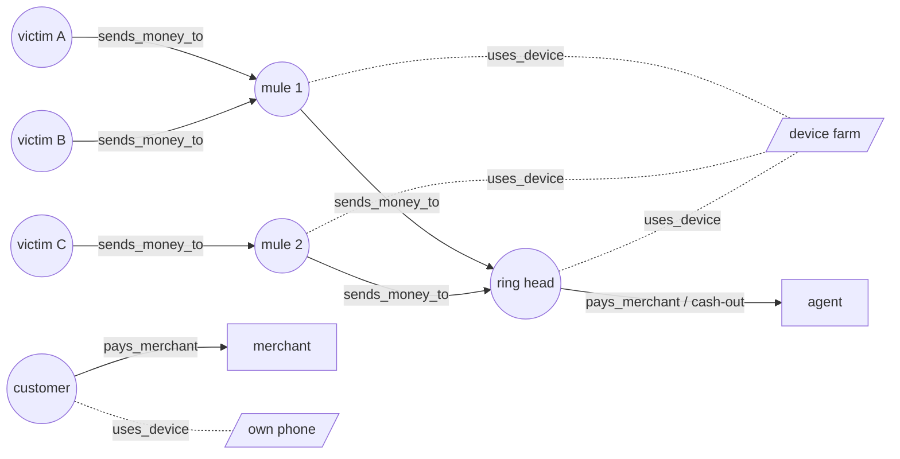

# Architecture

FinGuard simulates the risk and analytics backbone of a Mobile Financial Services (MFS) wallet
platform. **All data is synthetic**; nothing is connected to a real provider.

The design goal is *architectural coherence*: every component exists because a requirement
needs it, and the online and offline paths share code wherever correctness depends on it
(features, policy, schemas).

## 1. System architecture



| Component | Why it exists |
|---|---|
| **Kafka** (KRaft, no ZooKeeper) | Durable, replayable, partitioned event log. Decouples producers from several independent consumers (risk engine, Spark) that progress at their own pace; keyed by `customer_id` so per-customer order is preserved. |
| **Risk engine worker** | Per-event, low-latency, *stateful* scoring (features need the customer's previous events). Runs the same `FeatureEngine` as training. |
| **Redis** | Shared online feature state (customer / device / merchant documents) so the API and N workers see the same state; also the de-duplication set. |
| **Spark Structured Streaming** | High-throughput stream ETL: validation, quarantine, append-only bronze lake, event-time windows with watermarks. Throughput-oriented, not per-event decisions. |
| **S3-compatible lake (SeaweedFS)** | Cheap immutable storage of raw extracts and the bronze stream for replay/backfills. SeaweedFS replaces MinIO (whose images are no longer published); any S3 endpoint works. |
| **PostgreSQL** | Warehouse (raw → dbt star schema) and operational store (decisions, alerts, monitoring). One engine keeps the local stack light; the SQL is warehouse-portable. |
| **dbt** | Versioned, tested SQL transformations (star schema + marts) with lineage and data tests. |
| **Airflow** | Orchestrates batch pipelines with Dataset-driven scheduling, retries and idempotent tasks. |
| **MLflow** | Experiment tracking, model registry, alias-based promotion (`development → validation → production`) and rollback. |
| **FastAPI** | Synchronous scoring for authorisation-time decisions and read APIs for customer/transaction/alert intelligence. |
| **Prometheus** | System + ML metrics (throughput, latency, lag, decision mix, score distribution) and alert rules. |
| **Streamlit dashboard** | Decision-oriented pages over the marts; Power BI can use the same `analytics` schema. |

Deliberately **not** included: ZooKeeper (KRaft), Grafana (Prometheus + the dashboard's operations
page cover it), a feature-store product (Redis + one Python engine is enough at this scale), a
GNN (see [ml_methodology.md](ml_methodology.md#graph-analytics)).

## 2. Data pipeline



Idempotency everywhere: lake partitions are overwritten (`delete_matching`), warehouse loads are
full refreshes inside a transaction, dbt rebuilds tables, streaming sinks upsert on natural keys,
decisions are `ON CONFLICT DO NOTHING`.

## 3. ML pipeline

```mermaid
flowchart LR
    T[transactions] --> F[Replay through FeatureEngine<br/>point-in-time features]
    L[labels + reported_at] --> J
    F --> J[Join labels<br/>known before cutoff]
    J --> S[Temporal split<br/>train · validation · test]
    S --> X[XGBoost fraud<br/>imbalance strategy on val]
    S --> ATO[XGBoost ATO]
    S --> IF[Isolation Forest<br/>no labels]
    S --> BH[Behavioural baseline<br/>no labels]
    X --> C[Platt calibration<br/>+ thresholds on val]
    C --> E[Test evaluation<br/>PR-AUC, P@k, per-scenario recall, SHAP]
    E --> REG[MLflow: register @development]
    REG --> G{Validation gates}
    G -- pass --> V[@validation] --> P[@production<br/>previous kept for rollback]
    P --> D[models/ bundle<br/>API + risk engine]
    T --> GR[Graph analytics] --> PROF[Customer profiles]
    T --> SEG[Segmentation] --> PROF
    T --> CH[Churn snapshots] --> PROF
    X --> PROF
```

## 4. Fraud decision flow



The model never decides; it produces calibrated probabilities and explanations. The policy file
decides and can only be *escalated* by deterministic rules.

## 5. Database schema (star schema, `analytics`)



Grain, keys and lineage per table: [data_dictionary.md](data_dictionary.md).

## 6. Transaction graph



Nodes: customers, devices, merchants/agents. Edges: `sends_money_to` (P2P, weighted by amount),
`uses_device`, `pays_merchant`. Communities are found on the P2P + *shared*-device projection,
which is what ties mule rings together (see [fraud_detection.md](fraud_detection.md#graph-signals)).

## 7. Streaming semantics

* **Ordering**: Kafka key = `customer_id` → one customer's events are in one partition, in order;
  the feature engine relies on it.
* **Delivery**: at-least-once. Offsets are committed after a batch is persisted. The risk engine
  claims each `transaction_id` once (Redis `SET NX`) before touching state; sinks are idempotent.
* **Invalid data**: schema violations go to the DLQ with error headers (risk engine) or the lake
  quarantine zone with a reason (Spark). Poison records are isolated after retries so one bad
  message never blocks a partition.
* **Event time vs processing time**: Spark windows use `event_time` with a 10-minute watermark.
  The watermark (max event time seen − 10 min) tells Spark when a window is final and when state
  can be dropped; events older than the watermark are excluded from aggregates (counted as
  `numRowsDroppedByWatermark`) but still land in bronze for batch reconciliation.
* **State**: Spark keeps window and dedup state in checkpointed state stores (HDFS-backed
  provider on the lake), so restarts resume exactly where they stopped. The risk engine's state
  lives in Redis.
